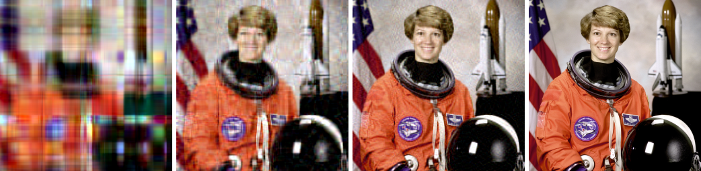
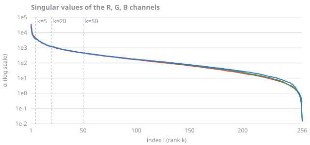
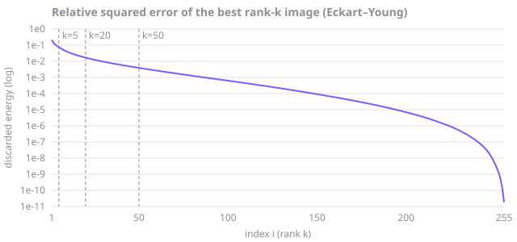
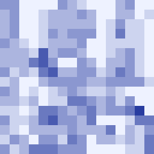
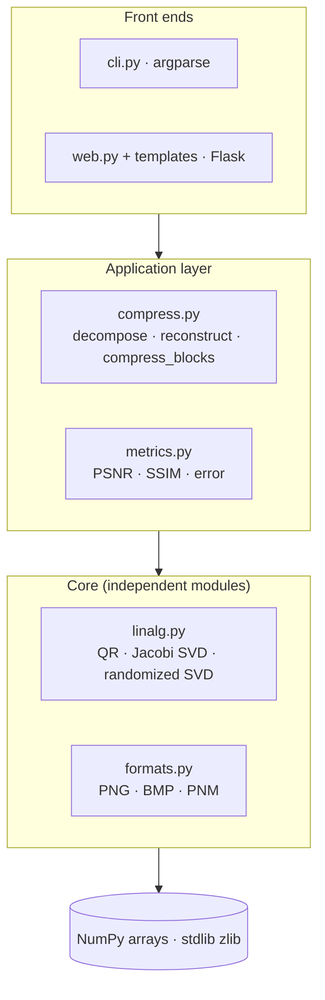
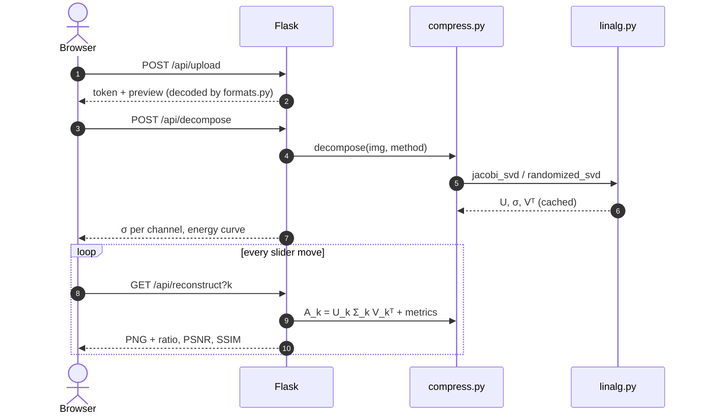

<div align="center">

# SVD Image Compression

**Compress images by keeping only the most important layers of their Singular Value Decomposition.**
<br>
Every algorithm is written from scratch: SVD, QR, metrics and image codecs. NumPy provides only array arithmetic.

[](https://github.com/varunkarthic/MAT248-SVD-Image-Compression/actions/workflows/ci.yml)
[](https://mat248-svd-image-compression.readthedocs.io/en/latest/)
[](https://www.python.org/)
[](LICENSE)
<br>
[](https://numpy.org/)
[](https://flask.palletsprojects.com/)
[](tests/test_purity.py)
[](tests)



<sub><b>k = 5</b> · 25.6× smaller &nbsp;│&nbsp; <b>k = 20</b> · 6.4× smaller &nbsp;│&nbsp; <b>k = 50</b> · 2.6× smaller, 99.6 % energy &nbsp;│&nbsp; <b>Original</b> 256 × 256 × 3</sub>

[**Documentation**](https://mat248-svd-image-compression.readthedocs.io/en/latest/) ·
[**Interactive demo**](https://mat248-svd-image-compression.readthedocs.io/en/latest/results.html) ·
[**Mathematics**](https://mat248-svd-image-compression.readthedocs.io/en/latest/mathematics.html) ·
[**Quick start**](#-quick-start)

</div>

---

## Contents

- [The idea in one equation](#-the-idea-in-one-equation)
- [Features](#-features)
- [Quick start](#-quick-start)
- [Usage](#-usage): CLI · Python · Web UI
- [Results](#-results)
- [Architecture](#-architecture)
- [Documentation](#-documentation)
- [Project layout](#-project-layout)
- [References](#-references)

## 💡 The idea in one equation

An image channel is a matrix $A \in \mathbb{R}^{m\times n}$. Its SVD writes it as a sum of rank-1 layers sorted by importance, and compression keeps the top $k$:

$$
A=\sum_{i=1}^{r}\sigma_i\,u_i v_i^{T}
\quad\longrightarrow\quad
A_k=\sum_{i=1}^{k}\sigma_i\,u_i v_i^{T},
\qquad
\underbrace{k(m+n+1)}_{\text{stored}}\ \ll\ \underbrace{mn}_{\text{pixels}} .
$$

> [!IMPORTANT]
> **Eckart–Young theorem.** $A_k$ is the *best* rank-$k$ approximation of $A$, and its error is exactly the energy that was thrown away:
> $\lVert A-A_k\rVert_F^2=\sum_{i>k}\sigma_i^2$.

<details>
<summary><b>Why does this work? (click to expand)</b></summary>
<br>

- **The SVD exists for every matrix.** $A^TA$ is symmetric positive semi-definite, so by the spectral theorem $A^TA = V\Lambda V^T$. Setting $\sigma_i=\sqrt{\lambda_i}$ and $u_i = Av_i/\sigma_i$ gives $A = U\Sigma V^T$.
- **Energy is spectral.** $\lVert A\rVert_F^2=\sum_i\sigma_i^2$, so the retained share is $E(k)=\sum_{i\le k}\sigma_i^2 / \sum_i\sigma_i^2$.
- **Compression pays off** only while $k < \dfrac{mn}{m+n+1}$. For $512\times512$ that means $k < 255.5$.
- **Natural images are nearly low rank.** Neighbouring pixels are correlated, so $\sigma_i$ falls by orders of magnitude within the first few dozen layers.

Full proofs, algorithms and error bounds are in the [mathematics chapter](https://mat248-svd-image-compression.readthedocs.io/en/latest/mathematics.html).

</details>

## ✨ Features

<table>
<tr>
<td width="50%" valign="top">

### 🧮 Linear algebra, from scratch
- **Householder QR**, batched
- **One-sided Jacobi SVD** with round-robin parallel ordering, QR preconditioning, and batching over channels or tiles
- **Randomized SVD** (Halko–Martinsson–Tropp) with power iterations

</td>
<td width="50%" valign="top">

### 🗜️ Compression modes
- **Global rank $k$**
- **Energy target**: the smallest $k$ that keeps a fraction $\tau$ of $\sum\sigma_i^2$
- **Adaptive blocks**: mean-centred tiles with a globally optimal rank allocation

</td>
</tr>
<tr>
<td valign="top">

### 📏 Quality metrics
- Compression ratio and stored-value count
- **PSNR**, **SSIM** (11 × 11 Gaussian window), MSE
- Relative Frobenius error and retained energy

</td>
<td valign="top">

### 🖼️ Codecs and interfaces
- **PNG** (1–16 bit, all colour types, CRC checks), **BMP**, **PGM/PPM**
- `svdcomp` CLI · Python API · `svdcomp-web` Flask UI
- **71 tests** and CI on Python 3.10–3.13

</td>
</tr>
</table>

## 🚀 Quick start

```bash
git clone https://github.com/varunkarthic/MAT248-SVD-Image-Compression.git
cd MAT248-SVD-Image-Compression
python -m venv .venv && source .venv/bin/activate
pip install -e ".[dev]"
pytest                                   # 71 tests
svdcomp compress photo.png out.png -k 50
svdcomp-web                              # open http://127.0.0.1:5000
```

## 🛠️ Usage

<details open>
<summary><b>Command line</b></summary>
<br>

```bash
svdcomp compress photo.png out.png -k 50                        # exact Jacobi SVD
svdcomp compress photo.png out.png -k 50 --method randomized    # fast, leading triplets only
svdcomp compress photo.png out.png --energy 0.999               # smallest k keeping 99.9 % energy
svdcomp compress photo.png out.png --blocks 16 --energy 0.95    # adaptive tiles
svdcomp info photo.png --sigma-csv sigma.csv                    # spectrum summary
svdcomp benchmark photo.png --ks 5,10,20,50,100 --csv bench.csv
```

```text
rank k        : 40
stored values : 153,720 / 1,228,800 (ratio 7.99x)
energy kept   : 99.988 %
PSNR          : 41.78 dB
SSIM          : 0.9840
rel. error    : 0.0112
time          : 0.26 s
```

| Command | Key options | Output |
| --- | --- | --- |
| `svdcomp compress IN OUT` | `-k K` · `--energy E` · `--blocks SIZE` · `--method exact\|randomized` | Image plus quality summary |
| `svdcomp info IN` | `--rank R` · `--sigma-csv FILE` | Spectrum and the $k$ needed for 90–99.9 % energy |
| `svdcomp benchmark IN` | `--ks 1,5,10` · `--csv FILE` | CSV of k, size, ratio, energy, PSNR, SSIM, error |

</details>

<details>
<summary><b>Python API</b></summary>
<br>

```python
from svdcomp.formats import read_image, write_image
from svdcomp.compress import compress, compress_blocks, decompose, result_for_rank

img = read_image("photo.png")                         # uint8 (H, W) or (H, W, C)

result = compress(img, k=50)                          # exact Jacobi SVD
print(f"{result.ratio:.1f}x  PSNR {result.metrics['psnr']:.1f} dB  SSIM {result.metrics['ssim']:.3f}")
write_image("photo_k50.png", result.image)

factors = decompose(img, method="randomized", rank=100)   # decompose once…
for k in (10, 25, 50, 100):                                 # …evaluate many ranks
    print(k, result_for_rank(img, factors, k).metrics["psnr"])

blocks = compress_blocks(img, block=16, energy=0.95)   # adaptive tiles
print(blocks.k)                                        # rank map, one entry per tile
```

</details>

<details>
<summary><b>Web UI</b></summary>
<br>

```bash
svdcomp-web                         # http://127.0.0.1:5000
svdcomp-web --host 0.0.0.0 --port 8000
```

1. **Upload** an image. PNG, BMP and PPM are decoded by our own codecs; JPEG, WebP and GIF are converted to PNG in the browser.
2. **Global rank k**: compute the SVD once (randomized, or exact up to 512 × 512), then drag the slider. Every move only re-multiplies the cached factors.
3. **Adaptive blocks**: choose a tile size and an energy target, then view the rank heat map.
4. Compare the images side by side with ratio, PSNR, SSIM and energy, the σ-decay chart and the Eckart–Young error curve. Download the result as PNG.

| Endpoint | Purpose |
| --- | --- |
| `POST /api/upload` | Decode and cache the image; returns a token |
| `POST /api/decompose` | Exact or randomized SVD; returns σ per channel and cumulative energy |
| `GET /api/reconstruct?token&k` | Rank-k image and metrics |
| `POST /api/blocks` | Adaptive block compression and rank map |

</details>

> [!TIP]
> Use `--method randomized` (the web UI's default) for large images. At 512 × 512 it takes **0.06 s** instead of **11 s** for the exact SVD, with an error provably close to optimal.

## 📊 Results

> [!NOTE]
> 👉 **[Try the interactive rank slider in the docs](https://mat248-svd-image-compression.readthedocs.io/en/latest/results.html).** Every image and number there was produced by this package (`scripts/make_figures.py`).

<table>
<tr>
<td width="50%"></td>
<td width="50%"></td>
</tr>
<tr>
<td align="center"><sub>Singular values per colour channel (log scale)</sub></td>
<td align="center"><sub>Best possible relative squared error versus k</sub></td>
</tr>
</table>

**Global vs adaptive blocks** (same 256 × 256 photo):

| Global SVD, k = 35 | Adaptive 16 × 16 tiles, τ = 0.95 | Rank per tile (darker = more) |
| :---: | :---: | :---: |
|  |  |  |
| 3.65× · 26.65 dB · SSIM 0.774 | **4.25× · 27.94 dB · SSIM 0.839** | ranks 0–6, mean 1.8 |

<details>
<summary><b>Rank vs quality on a 512 × 512 photo, and runtime</b></summary>
<br>

| k | Stored numbers | Ratio | Energy kept | PSNR (dB) | SSIM |
| ---: | ---: | ---: | ---: | ---: | ---: |
| 5 | 5,125 | 51.2× | 99.634 % | 27.79 | 0.915 |
| 10 | 10,250 | 25.6× | 99.904 % | 33.57 | 0.952 |
| 20 | 20,500 | 12.8× | 99.978 % | 40.00 | 0.979 |
| 50 | 51,250 | 5.1× | 99.997 % | 48.90 | 0.995 |
| 100 | 102,500 | 2.6× | ≈100 % | 56.30 | 0.998 |

| Grayscale size | Exact Jacobi SVD | Randomized SVD (k = 50) |
| --- | ---: | ---: |
| 128 × 128 | 0.21 s | 0.06 s |
| 256 × 256 | 1.23 s | 0.04 s |
| 512 × 512 | 11.0 s | 0.06 s |

<sub>Apple M4, Python 3.14, NumPy 2.5.</sub>

</details>

> [!CAUTION]
> "Stored numbers" counts values, not bytes. Factors stored as 32-bit floats take 4× the space of 8-bit pixels unless they are quantised. This is one reason plain SVD loses to JPEG in the literature (Jiang, 2025).

## 🏗️ Architecture



<details>
<summary><b>Request flow in the web UI</b></summary>
<br>



The SVD runs **once** per upload. Each slider move only costs $O(kmn)$ to re-multiply the cached factors.

</details>

> [!NOTE]
> **Purity is enforced.** [`tests/test_purity.py`](tests/test_purity.py) fails the build if package code imports PIL, SciPy, OpenCV, scikit-image or imageio, or calls NumPy's `linalg`.

## 📚 Documentation

The [Sphinx documentation](https://mat248-svd-image-compression.readthedocs.io/en/latest/) includes:

| Chapter | What it covers |
| --- | --- |
| [Getting started](https://mat248-svd-image-compression.readthedocs.io/en/latest/usage.html) | Install, CLI, Python, web UI, JSON API |
| [Results](https://mat248-svd-image-compression.readthedocs.io/en/latest/results.html) | Interactive rank slider, spectra, global vs blocks, runtime |
| [Mathematics](https://mat248-svd-image-compression.readthedocs.io/en/latest/mathematics.html) | SVD via the spectral theorem, Eckart–Young–Mirsky proofs, Householder QR, Jacobi rotations and convergence, randomized SVD bounds, optimal block allocation, PSNR/SSIM, worked example |
| [Architecture](https://mat248-svd-image-compression.readthedocs.io/en/latest/architecture.html) | Layers, data flow, design decisions, complexity budget |
| [API reference](https://mat248-svd-image-compression.readthedocs.io/en/latest/api.html) | Generated from the docstrings |

```bash
pip install -e ".[docs]"
sphinx-build -b html docs docs/_build/html      # local build
python scripts/make_figures.py                  # regenerate all figures with svdcomp
```

## 🗂️ Project layout

```text
svdcomp/
├── linalg.py        Householder QR · one-sided Jacobi SVD · randomized SVD
├── compress.py      rank-k · energy target · adaptive blocks · storage accounting
├── metrics.py       MSE · PSNR · SSIM · relative error
├── formats.py       PNG · BMP · PGM/PPM codecs
├── cli.py           `svdcomp` command
├── web.py           Flask app (`svdcomp-web`)
└── templates/       single-page web UI
scripts/make_figures.py   reproducible README/docs figures
tests/                    pytest suite (linalg, codecs, compression, web, purity)
docs/                     Sphinx sources (Read the Docs)
```

## 📖 References

1. C. Eckart, G. Young. *The approximation of one matrix by another of lower rank.* Psychometrika, 1936.
2. N. Halko, P.-G. Martinsson, J. A. Tropp. [*Finding structure with randomness.*](https://arxiv.org/abs/0909.4061) SIAM Review, 2011.
3. Z. Drmač, K. Veselić. *New fast and accurate Jacobi SVD algorithm.* SIAM J. Matrix Anal. Appl., 2008.
4. Z. Wang, A. C. Bovik, H. R. Sheikh, E. P. Simoncelli. *Image quality assessment: from error visibility to structural similarity.* IEEE TIP, 2004.
5. Z. Golpayegani, N. Bouguila. *PatchSVD: A non-uniform SVD-based image compression algorithm.* 2024.
6. J. Jiang. *Image compression using singular value decomposition.* 2025.

<div align="center">
<sub>Built for MAT248 · <a href="LICENSE">MIT License</a> · Image credit: astronaut Eileen Collins, NASA (public domain)</sub>
</div>
